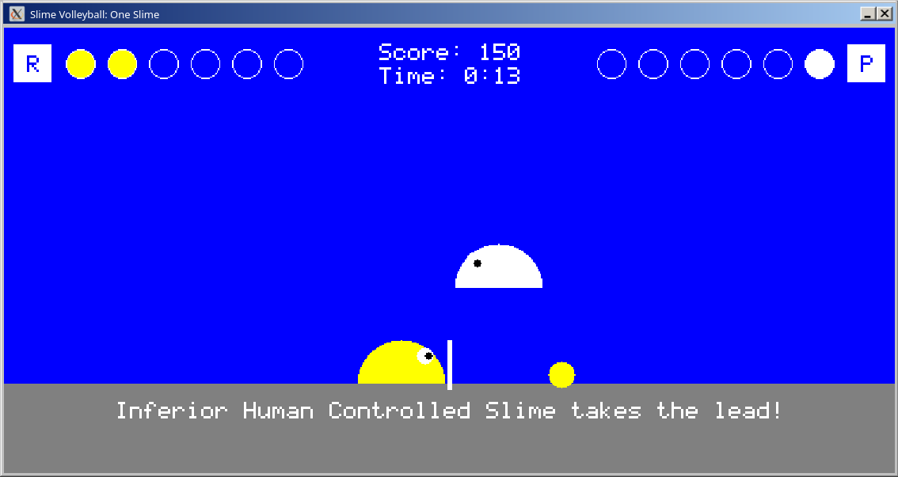

# Slime Volleyball

A desktop and browser volleyball game written in Zig, C, and SDL2. Play through
three solo stages against computer opponents, or play a local two-player match.



Win a rally by landing the ball on the other side. The rally winner serves next,
and the first player to six points wins the match. The ball drops automatically
over the server. Solo play awards points for rallies, level completion, speed,
and flawless victories. Each stage has its own court and opponent colors.

## Controls

| Input | Action |
| --- | --- |
| **Left / Right**, **Up** | Move and jump as player 1 on the left |
| **A / D**, **W** | Move and jump as player 2 on the right in local play |
| **Touch drag left / right** | Move until the finger lifts; reversing the drag reverses direction |
| **Touch drag up** | Jump, including while moving horizontally |
| **Space** or **R button** | Request replay during a point break, or leave replay; button grey when unavailable |
| **P** or **P button** | Pause or resume |
| **Continue button** | Resume a pause, retry the current stage after a loss, or advance after a stage win |
| **One / two player buttons** | Start a new game from any menu |

Mode selection and Continue respond only to mouse clicks or touch taps.
Continue is disabled on the initial screen. Pausing opens the same three-button
menu. After completing the solo campaign, Continue starts a new solo run; after
a local match, it starts a rematch. The R replay button is at the top left, and
the P pause button is at the top right.

In local touch play, the left and right halves control their respective slimes
with separate fingers. In solo mode, dragging anywhere controls the human.
Keyboard and touch can be mixed; releasing a drag restores any held keyboard
direction. Focus loss, pause, and rally resets cancel active gestures.

## Desktop

Use **Zig 0.17.1**. SDL **2.32.10** is built from the sources in `deps/sdl2`.
On Ubuntu, install the X11 and OpenGL headers:

```sh
sudo apt install libxext-dev libgles-dev libglx-dev
```

Build and play:

```sh
zig build
zig build run
```

The executable is `zig-out/bin/slime-vball` (`.exe` on Windows). For a release
build, add `-Doptimize=fast`. Desktop and browser builds display the court at
1125 × 563 pixels by default.

## Browser

```sh
zig build install-emsdk
zig build -Dtarget=wasm32-emscripten -Doptimize=fast run
```

The first command installs the **Emscripten 7.0.0** SDK. Tap or click the court
to focus the keyboard. To serve without launching a browser, append
`-- --no_browser` to the run command.

Serve `index.html`, `index.js`, and `index.wasm` together from `zig-out/web`.

Tap **Fullscreen** to fit the court to the screen. Use the browser's fullscreen
exit gesture or **Esc** to return to the page. The court keeps its proportions,
with black bars where needed; the caption is hidden during fullscreen play.
On iPhone, use Safari's **Share → Add to Home Screen**, enable **Open as Web App**
if shown, and launch the Home Screen icon. Home Screen play uses the same layout.

## Development

Run the checks with:

```sh
zig build test
```

The tests cover menus, keyboard and touch input, campaign progression, replay,
pause, SDL surface colors, and 24,576 computer-player decisions. AI checks cover
command order, serve state, and random call counts.

The source is organized as follows:

- `src/main.zig`: program entry point, SDL initialization, and desktop/browser loops.
- `src/main.c`: physics, SDL drawing, and movement primitives, called by Zig.
- `src/input.zig`: mouse/touch button activation, drag gestures, and keyboard input.
- `src/game.zig`: game phases, progression, scoring, commentary, and pause.
- `src/ai.zig`: computer-player input and interception prediction.
- `src/replay.zig`: position history and replay playback.
- `src/ui.zig` and `src/font.zig`: palettes, bitmap text, menus, results, and HUD.

Shared types and interfaces live in `src/game.h`, `src/app.h`, and `src/ui.h`.
The build translates `src/bridge.h` to Zig bindings, so the C headers define the
shared ABI. The UI checks are implemented in `tests/ui.zig`, exercising the
modules through the same interface used by `main.c`. The checks also support
optional BMP screenshot output.

See [COPYING](COPYING) for the license.
